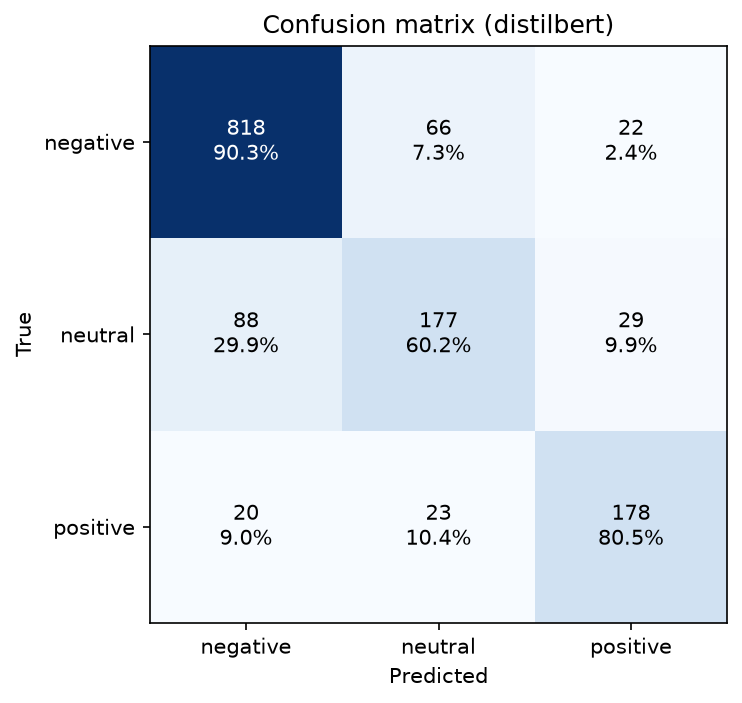
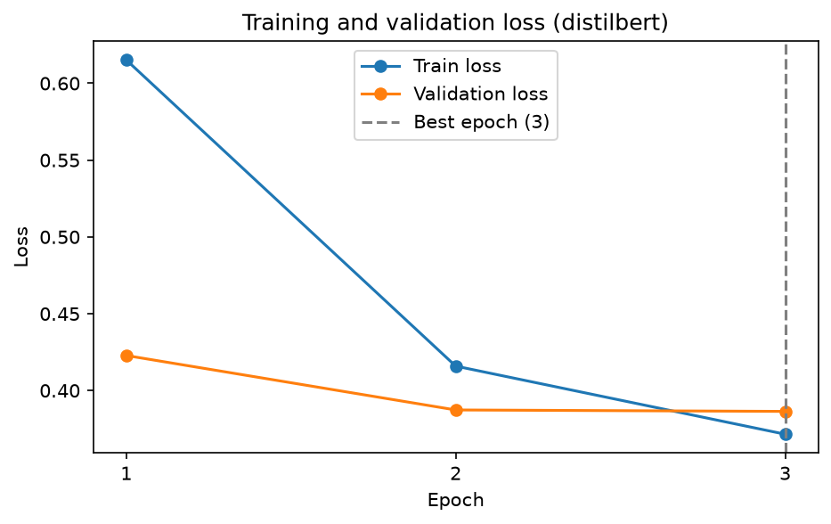

# Airline Sentiment Classification by Fine-Tuning DistilBERT

Three-class sentiment classification (negative / neutral / positive) of US airline tweets, by
fine-tuning a pretrained DistilBERT encoder with a classification head. Trained on CPU.

## Dataset

- The Twitter US Airline Sentiment dataset, 14,640 tweets labelled negative, neutral or positive.
- 436 duplicates removed, leaving 14,204 tweets.
- Split 80/10/10, stratified: 11,363 train, 1,420 validation, 1,421 test.
- Only `text` and `airline_sentiment` are kept.

## Results

Test set using the weights of the best validation epoch.

| Class | Precision | Recall | F1 | Support |
| --- | --- | --- | --- | --- |
| negative | 0.8834 | 0.9029 | 0.8930 | 906 |
| neutral | 0.6654 | 0.6020 | 0.6321 | 294 |
| positive | 0.7773 | 0.8054 | 0.7911 | 221 |

Accuracy 0.8255, macro F1 0.7721, weighted F1 0.8232.

`neutral` is the weakest class.



## Preprocessing

The model is fed the original tweet text, with only HTML entities decoded.

## Model

`distilbert-base-uncased`: six transformer layers, hidden size 768, twelve attention heads.

| | Parameters |
| --- | --- |
| Total | 66,955,779 |
| Trainable | 21,856,515 (32.6%) |
| Frozen | embeddings and layers 0–2 |


## Tokenization

- WordPiece, 30,522 tokens, loaded with the pretrained weights.
- Padding length 43, the 95th percentile of the training lengths in subword units. 4.6% of tweets
  lose their tail.
- The attention mask is passed at every forward pass, so no layer attends to padding.

## Fine-tuning


| Epoch | Train loss | Validation loss | Time |
| --- | --- | --- | --- |
| 1 | 0.6152 | 0.4228 | 88.5 min |
| 2 | 0.4159 | 0.3873 | 66.3 min |
| 3 | 0.3715 | 0.3864 | 51.6 min |




## Project structure

- `data/raw/Tweets.csv` — the original dataset
- `src/config.py` — paths, random seed, column names and model settings
- `src/preprocessing.py` — loading, deduplication and HTML decoding
- `src/tokenization.py` — label encoding, splitting and WordPiece encoding
- `src/model.py` — the pretrained encoder, the classification head and layer freezing
- `src/train.py` — the fine-tuning loop and the optimizer 
- `src/evaluate.py` — metrics, loss curves and the confusion matrix
- `notebooks/01_airline_sentiment_transformer.ipynb` — the analysis, with markdowns and results
- `reports/figures/` — plots

## Setup

```bash
python -m venv venv
venv\Scripts\activate
pip install -r requirements.txt
```

Then open `notebooks/01_airline_sentiment_transformer.ipynb` and run all cells. The pretrained
weights are downloaded on first use. Results are reproducible: every random source is seeded from a
single value in `src/config.py`.

## Author

Vasileios Loizidis
